# Hand-Tracking Physics Game

A real-time computer-vision interaction experiment in which hand tracking is used to draw temporary barriers and control a physics-based game.

Built with Python, OpenCV, MediaPipe, NumPy, and Pillow, the project combines hand tracking, 2D geometry, collision detection, lightweight physics, game-state management, and interactive visual feedback.

The project began as a small prototype in 2024 and was revisited in 2026 through two successive revisions. The repository keeps all three stages together so the technical evolution can be inspected directly in the source code.

## At a Glance

- **Domain:** Computer Vision / HCI / Real-Time Interaction
- **Input:** Webcam-based hand tracking
- **Core interaction:** Index-finger drawing and ball reflection
- **Extended interaction:** Hand-as-paddle and fist-based shield
- **Implementation:** Python with OpenCV, MediaPipe, NumPy, and Pillow
- **Evolution:** Original prototype → structured revision → creative revision

## Gameplay Demos

The GIFs below provide a quick look at each stage of the project without requiring you to install or run the code.

### Original Prototype — 2024

The first version demonstrates the original webcam-based interaction and the core gameplay loop.

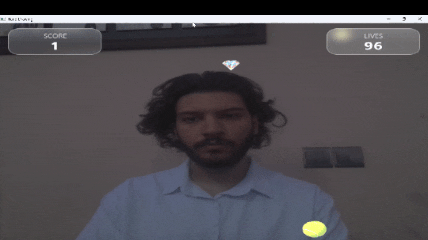

### Structured Revision — 2026

This revision keeps the central interaction while organizing the implementation into more clearly separated components.

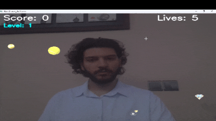

### Creative Revision — 2026

The latest version explores additional interaction mechanics, including hand-as-paddle control, a fist-based shield, and richer visual feedback.

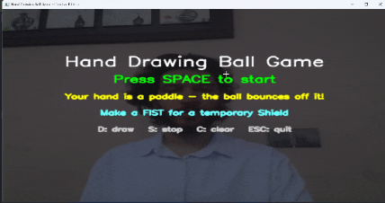

## Screenshot Gallery

The following screenshots show selected screens and interactions from the three versions. They complement the animated demos above by making individual interface states and gameplay details easier to inspect.

### Original Prototype

**Start screen**

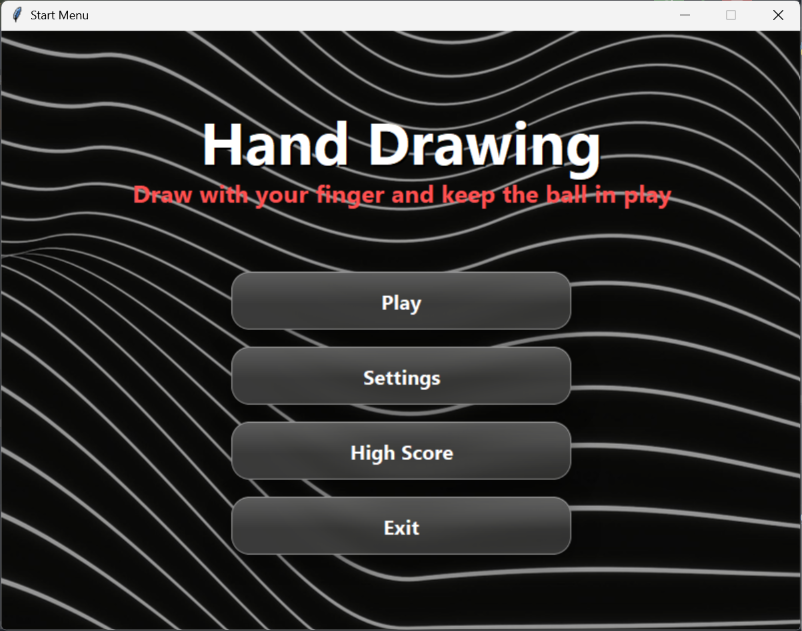

**Gameplay**

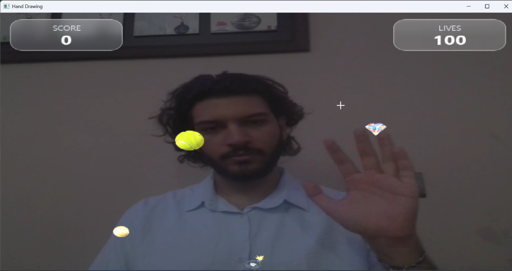

**End screen**

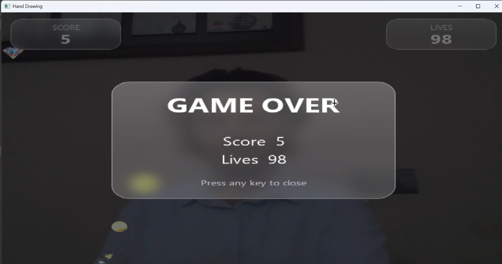

### Structured Revision

**Start screen**

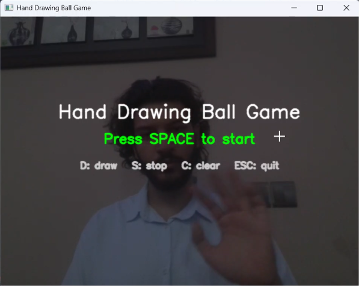

**Gameplay**

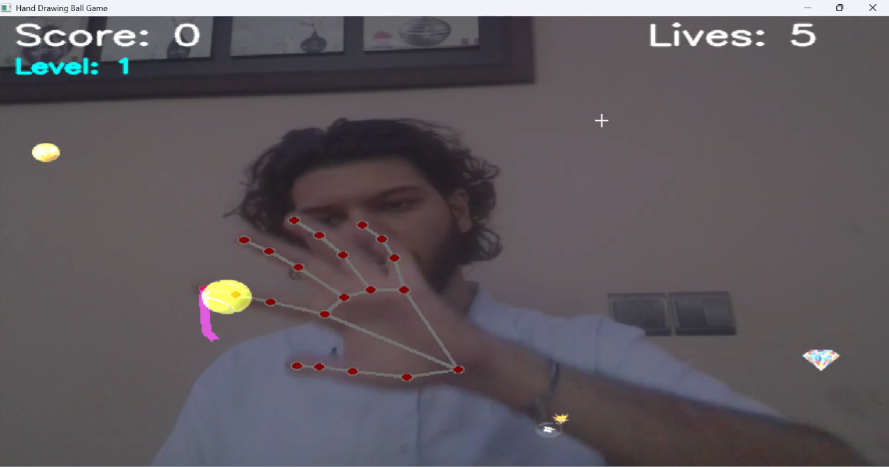

### Creative Revision

**Start screen**

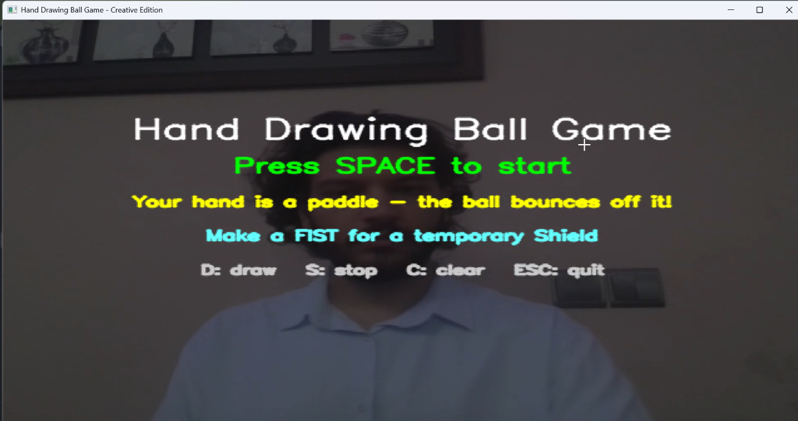

**Ball interaction — example 1**

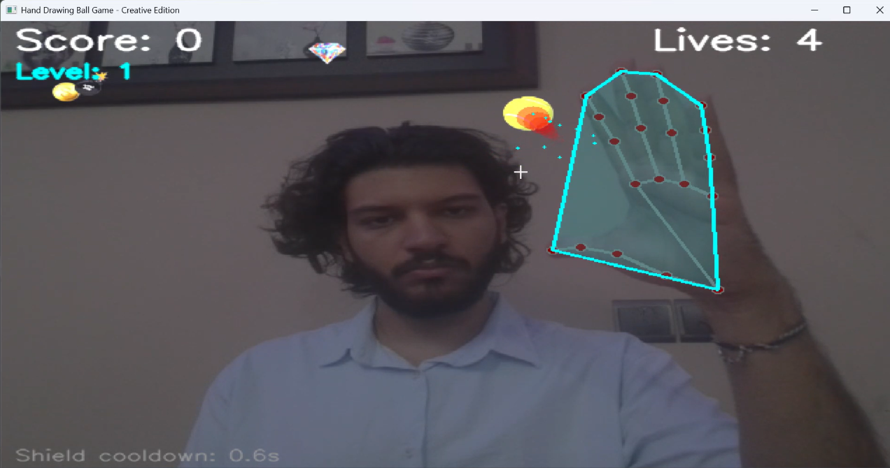

**Ball interaction — example 2**

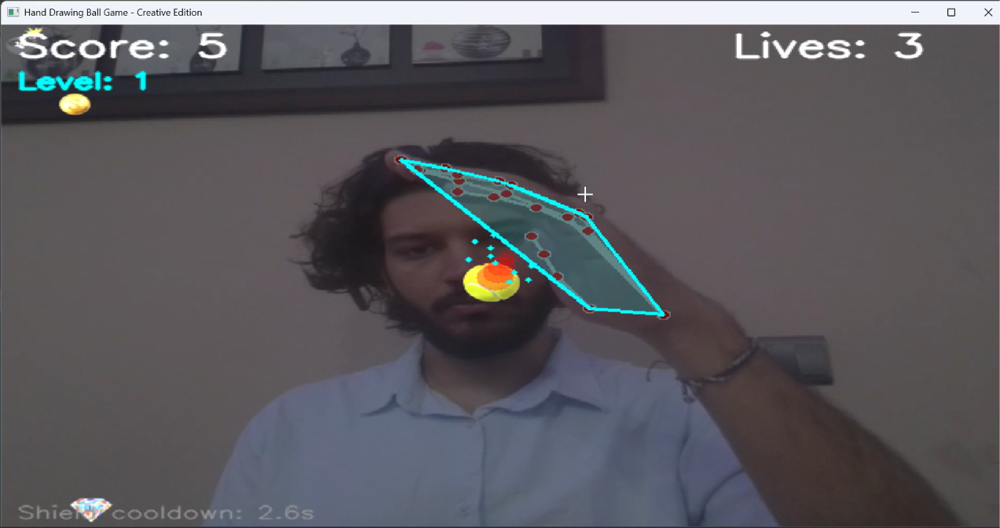

**Fist gesture and shield**

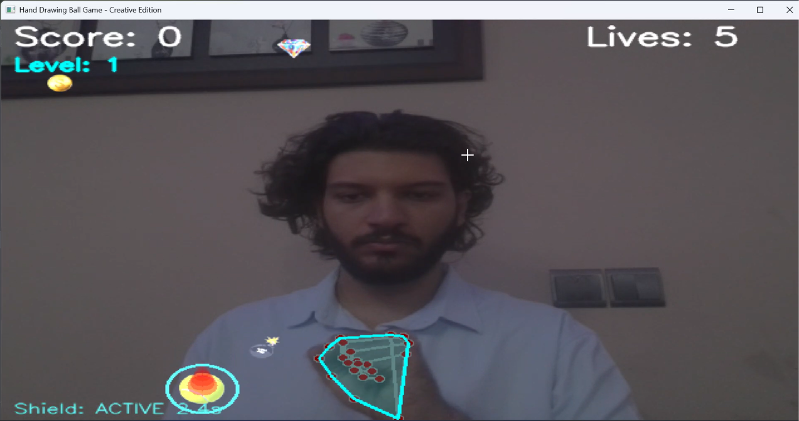

## Project Demo

A demonstration of the hand-controlled interaction is also available in the project's LinkedIn post:

[View the demonstration on LinkedIn](https://www.linkedin.com/posts/kianshojaei_mediapipe-opencv-activity-7245463781684723713-Vow7?utm_source=share&utm_medium=member_desktop&rcm=ACoAADXrbU8B6qFFmEzVSm8aFXdvGZGWAb4c0nE)

## Project Evolution

### 1. Original Prototype — 2024

**File:** `Source/original_prototype.py`

The original implementation established the core interaction:

- Track the user's hand through a webcam.
- Use the index fingertip as the drawing input.
- Create short-lived line segments on the screen.
- Let the ball interact with those drawn segments through vector reflection.
- Collect bonuses and power-ups.
- Handle lives and bomb interactions.
- Render the game over the live camera feed.

This version intentionally remains close to the original implementation. It represents the starting point of the project rather than the final architecture.

### 2. Structured Revision — 2026

**File:** `Source/structured_revision_2026.py`

The second version revisits the original idea from an engineering perspective.

The main changes include:

- Object-oriented game structure.
- Centralized configuration through `Config`.
- Explicit game states for start, gameplay, and game over.
- Separate components for hand tracking, drawing, game objects, and ball physics.
- More explicit resource and webcam handling.
- Clearer image-loading errors.
- Difficulty progression through ball-speed scaling.
- Finite line-segment collision geometry.
- Restart and canvas-clear controls.

The interaction remains intentionally close to the original prototype while the internal organization is substantially cleaner.

### 3. Creative Revision — 2026

**File:** `Source/creative_revision_2026.py`

The third version extends the structured game into a richer interactive experiment.

Additional mechanics include:

- The tracked hand can act as a temporary paddle.
- Convex-hull geometry is used to represent the hand for paddle interaction.
- A fist gesture activates a temporary shield.
- Combo scoring rewards quick successive collections.
- A second ball is introduced at higher difficulty.
- Ball trails provide motion feedback.
- Particle effects are used for collisions and item collection.
- Bomb interactions include temporary visual feedback.
- The HUD and interaction feedback are expanded.

This version focuses on exploring how hand tracking can become part of the game mechanics itself rather than serving only as an input method.

---

## Core Interaction

The central idea is simple:

**Draw a line with your hand → the ball reacts to it → collect items → survive the hazards.**

The later revision adds another interaction layer:

**Move your hand as a paddle → use gestures → interact with the game more directly.**

## Technical Pipeline

```text
Webcam Frame
     ↓
MediaPipe Hands
     ↓
Hand Landmarks
     ↓
Pixel Coordinates
     ↓
Drawing / Hand Geometry
     ↓
Collision Detection
     ↓
Vector Reflection
     ↓
Game Physics
     ↓
Game State
     ↓
Rendering and HUD
```

The project therefore combines several areas in one real-time loop:

- Computer Vision
- Hand Tracking
- Human-Computer Interaction
- 2D Geometry
- Basic Physics
- Real-Time Rendering
- Interactive Game Design

## Interaction Model

| Interaction | Prototype | Structured Revision | Creative Revision |
|---|:---:|:---:|:---:|
| Index-finger drawing | ✓ | ✓ | ✓ |
| Temporary drawing barriers | ✓ | ✓ | ✓ |
| Ball reflection | ✓ | ✓ | ✓ |
| Bonus collection | ✓ | ✓ | ✓ |
| Power-up system | ✓ | ✓ | ✓ |
| Life power-up | ✓ | ✓ | ✓ |
| Bomb hazard | ✓ | ✓ | ✓ |
| Explicit game states | — | ✓ | ✓ |
| Hand as paddle | — | — | ✓ |
| Fist-based shield | — | — | ✓ |
| Combo scoring | — | — | ✓ |
| Multiple balls | — | — | ✓ |
| Particle effects | — | — | ✓ |
| Ball trail | — | — | ✓ |

## Physics and Collision

The ball is represented by a position, velocity, and radius.

When the ball interacts with a drawn barrier, the implementation uses the normal of the segment to reflect the velocity vector. The revised versions also evaluate the distance to the **finite segment**, rather than treating the stroke as an infinitely long line.

A small separation step is applied after a collision to reduce repeated overlap with the same barrier.

The creative revision applies the same reflection idea to the hand-paddle interaction.

## Hand Tracking

The project uses MediaPipe Hands to obtain hand landmarks from the webcam stream.

The original prototype uses the index fingertip as its primary interaction point.

The structured revision isolates hand tracking into a dedicated `HandTracker` component.

The creative revision builds further on the landmark data to:

- Convert landmarks to pixel coordinates.
- Construct a convex hull around the hand.
- Detect a fist using a geometric heuristic.
- Use the hand geometry as an additional collision surface.

## Game State

The structured and creative revisions explicitly separate the main game states:

```text
START
  ↓
PLAYING
  ↓
GAME_OVER
  ↓
PLAYING
```

This makes starting, restarting, and game-over behavior easier to manage than in the original prototype.

## Controls

The revised versions use the following keyboard controls:

| Key | Action |
|---|---|
| `SPACE` | Start / restart the game |
| `D` | Start drawing |
| `S` | Stop drawing |
| `C` | Clear the drawing canvas |
| `R` | Switch drawing color to red |
| `P` | Switch drawing color to purple |
| `ESC` | Quit |

The original prototype has a smaller keyboard-control set and is intentionally preserved as the earlier implementation.

## Installation and Setup

### Requirements

- Python 3.10 or a version supported by the installed MediaPipe release
- A working webcam
- The Python packages listed in `requirements.txt`

### Install dependencies

Create and activate a virtual environment, then install the dependencies:

```bash
python -m venv .venv
```

On Windows:

```powershell
.venv\Scripts\Activate.ps1
```

On macOS or Linux:

```bash
source .venv/bin/activate
```

Install the packages:

```bash
python -m pip install --upgrade pip
pip install -r requirements.txt
```

### Run a version

Run one of the scripts from the repository root:

```bash
python Source/original_prototype.py
```

Or choose a revised version:

```bash
python Source/structured_revision_2026.py
python Source/creative_revision_2026.py
```

The scripts use the default webcam. Close other applications that may be using the camera if it cannot be opened. The five required gameplay assets are stored in `GameImages/`; the scripts resolve their paths relative to the repository, so you can launch them from the repository root or another working directory.

## Project Structure

```text
Hand-Tracking-Physics-Game/
├── GameImages/
│   ├── ball.png
│   ├── bomb.png
│   ├── bonus.png
│   ├── life_powerup.png
│   └── powerup.png
├── GamePlay/
│   ├── original_prototype.gif
│   ├── structured_revision.gif
│   └── creative_revision.gif
├── Image/
│   ├── creative_revision_ball_hit1.png
│   ├── creative_revision_ball_hit2.png
│   ├── creative_revision_shield_fist.png
│   ├── creative_revision_start_page.png
│   ├── original_prototype_end_page.png
│   ├── original_prototype_game_page.png
│   ├── original_prototype_start_page.png
│   ├── structured_revision_game_page.png
│   └── structured_revision_start_page.png
├── Source/
│   ├── original_prototype.py
│   ├── structured_revision_2026.py
│   └── creative_revision_2026.py
├── requirements.txt
├── .gitignore
├── LICENSE
└── README.md
```

The three source files are kept separately rather than replacing one version with another. This makes the development history and technical progression easier to inspect.

## Why Keep Three Versions?

The three implementations answer different questions.

**Original Prototype**

> Can hand tracking be used to draw temporary barriers that influence a moving ball?

**Structured Revision**

> How can the original experiment be reorganized into clearer, reusable components?

**Creative Revision**

> How far can the hand itself become part of the game mechanics?

Keeping all three versions makes these changes visible in the code rather than describing them only in documentation.

## Development Approach

The project was originally created as an experimental computer-vision interaction project and later revisited as a technical refinement and feature-development exercise.

The later revisions focus on:

- Refactoring the original implementation.
- Making technical responsibilities clearer.
- Improving collision handling.
- Adding explicit game states.
- Exploring additional interaction patterns.
- Experimenting with richer feedback and gameplay.

The source code is intentionally kept readable so that the implementation decisions can be followed directly.

## Technical Stack

- **Python**
- **OpenCV**
- **MediaPipe**
- **NumPy**
- **Pillow**

## Limitations

The project is an interactive prototype rather than a production-ready game engine.

Current limitations include:

- Performance depends on webcam resolution and hardware.
- Hand tracking can be affected by lighting, occlusion, and camera quality.
- Gesture detection uses geometric heuristics rather than a trained gesture-classification model.
- The physics model is intentionally lightweight.
- The original prototype assumes a default webcam setup and has less defensive error handling than the later revisions.

## Future Directions

Potential extensions include:

- More robust gesture classification.
- Better calibration for different camera setups.
- More sophisticated collision handling.
- Additional game mechanics driven by hand gestures.
- Performance profiling and optimization.
- A cleaner separation between the rendering layer and game logic.

## Project Context

HandTrackingGame is part of a broader set of experiments exploring real-time computer vision and human-computer interaction.

The project is particularly useful as a compact example of how a computer-vision input stream can be connected to geometry, physics, state management, and interactive feedback in a single application.

---

**Author:** Kian Shojaei  
**Repository:** [KianShojaei/HandTrackingGame](https://github.com/KianShojaei/Hand-Tracking-Physics-Game)
